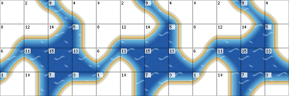

# Corner sheets - layout for artists

A corner sheet is the art of one corner-edged terrain kind, such as water.
The Engine draws the kind's edges on the corners between map cells from it,
so diagonal shorelines, bends and one-cell streams are smooth instead of
stair-stepped. The contract and its reasons are in
[layered tilemaps, Stage 7](layered-tilemaps.md#corner-edged-kinds).



## Size

- One PNG per kind, at the tileset's tile size (48 px recommended).
- Each phase is a block of 4 x 4 tiles: 192 x 192 at 48 px.
- A still kind (sand, grass, road) has one phase: 192 x 192.
- Animated water has three phases side by side: 576 x 192. The game cycles
  them 0, 1, 2, 1, one step every half second, as RPG Maker A1 water.

The Engine reads the phases and tile size from the image, so replacing the
file needs nothing else. Bind it in Database > Tilesets > Terrain Kinds >
Corner Sheet.

## What a tile is

Each tile is drawn centred on a corner where four map cells meet. Its own
four corners are the centres of those four cells. Which of those cells hold
the kind picks the tile, its case: top left 1, top right 2, bottom left 4,
bottom right 8, added together.

| Row | Column 0 | Column 1 | Column 2 | Column 3 |
| --- | --- | --- | --- | --- |
| 0 | 0 (none) | 2 | 9 | 4 |
| 1 | 8 | 12 | 14 | 5 |
| 2 | 6 | 11 | 15 (all) | 13 |
| 3 | 1 | 10 | 7 | 3 |

The block is one seamless picture. These are its tile corner points, `#`
where the kind lies; the last row and column repeat the first:

```
. . # . .
. . . # .
. # # # .
# . # # #
. . # . .
```

## Painting rules

1. Paint each phase as one picture over that point grid. Every tile side
   continues into the tile beside it, and the right edge continues into the
   left, the bottom into the top.
2. Where an edge crosses a tile side, it crosses at the side's midpoint (24 px
   at 48 px) and at a right angle. Any two tiles that meet on a map then
   continue each other.
3. Cases 6 and 9 hold the kind on opposite corners: join them through the
   tile's centre, so a stream one cell wide stays connected along a diagonal.
4. Corners read best as flattened curves. Round quarter circles make every
   diagonal shoreline scallop; the placeholder uses flattened curves
   (`tools/corner-sheet-placeholder.php`).
5. Case 0 (the top-left tile) is never drawn; leave it transparent. Case 15
   repeats across open water, so it must tile with itself.
6. Outside the kind, leave the tile transparent; the ground beneath shows.
   A shore band, foam or a damp line may sit on either side of the edge.
7. Ripples and texture must repeat a whole number of times across one tile,
   so they continue from tile to tile.
8. Water phases move the surface only. Keep the edge and the shore in the
   same place in all three phases.
9. Passage comes from the map's cells, never from the art. On straight runs
   the edge lies on the cell edge; at corners it cuts into or fills about a
   quarter of a cell. Keep the shore narrow, so where the player can walk
   still reads at a glance.
